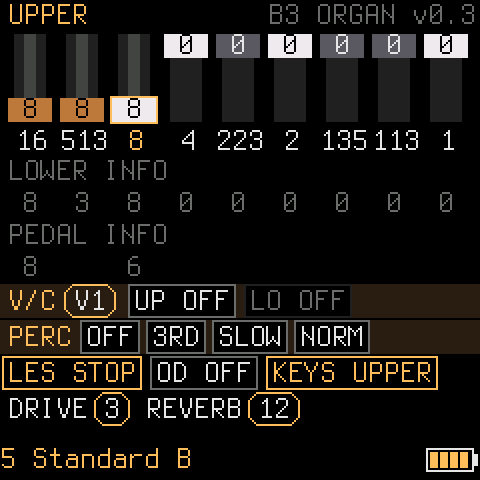

# B3 ORGAN for the M-VAVE FM-1

**A Hammond B3 tonewheel organ for the M-VAVE FM-1, modelled on [setBfree](https://github.com/pantherb/setBfree).**
91 tonewheels, nine drawbars, key click, vibrato and chorus, percussion, overdrive, reverb and a Leslie with
horn and drum, all in integer arithmetic on the FM-1's JieLi AC791N (no FPU, no 64-bit division).

<p align="center"></p>

The organ follows setBfree wherever that is practical: its tonewheel gear ratios, the tapering and the crosstalk
between wheels from its compiled play matrix, key click and key compression, the vibrato scanner, the reverb, the
Leslie, its factory programs (`default.pgm`) and its MIDI controller numbers. Where a number could be measured against
the real thing (setBfree on a computer, or a recording of its LV2 plug-in), it was; the host tests check them on every
build.

**Try it in the browser:** [r-jeb.github.io/setBfree-fm1/play](https://r-jeb.github.io/setBfree-fm1/play/), the same engine as WebAssembly (`web/`, rebuilt with `web/build.sh`; `docs/play/index.html` is a copy of `web/index.html`).

> **Status:** 0.2, tested on an FM-1 by one person. Please report what sounds different from setBfree.

## What you get

| | |
| --- | --- |
| **Tonewheels** | 91 wheels with setBfree's 60 Hz gear ratios, nine drawbars, setBfree's tapering (-10 to +7 dB per key and drawbar) and wheel-to-wheel leakage down to -60 dB. Only the wheels that sound are computed (about 27 µs each). |
| **Key click, key compression** | setBfree's attack click (eight random envelopes) and the gain drop when many keys are held (1.2 dB for 2 keys, to 9 dB for 61). |
| **Vibrato and chorus** | V1 to V3 and C1 to C3 as setBfree's scanner (a sine-swinging delay at 7.25 Hz); matches a setBfree recording in pitch swing (14.8 cents) and to within half a dB in ripple. |
| **Percussion** | 2nd or 3rd harmonic, slow or fast decay, soft or normal, level and decay as setBfree's tone generator (within 0.4 dB), and its key click: setBfree differentiates the percussion bus with the key's attack envelope, so the bouncing attack comes out as a click. |
| **Overdrive** | setBfree's own preamp model: biased transfer curve between two bass filters, feedback, sag; nine character settings (setBfree's `overdrive.character` 0, 16 … 127). |
| **Battery** | A four-bar cell at the bottom right of the screen; a bolt instead when a USB host has the FM-1. |
| **Reverb** | setBfree's reverb (combs and all-passes), amount on KNOB 4 or CC 91; impulse response within -45 dB of setBfree's. |
| **Leslie** | setBfree's rotary model: horn and drum with Doppler, horn directivity, reflections, stop / slow / fast with acceleration and braking; the stopped state matches setBfree's to about -40 dB. |
| **Programs** | All 110 programs of setBfree's `default.pgm` (registrations and switch settings), by the PRESETS knob or MIDI program change. |
| **MIDI** | USB and the TRS jack, any channel, setBfree's default controller numbers (drawbars 70 to 78, swell 7 / 11, Leslie 1 / 64, vibrato 31 / 92, percussion 66 / 80 to 83, overdrive 65 / 93, reverb 91). |
| **USB audio, updates, rescue** | The platform underneath (Felucca, SLOOP, Dinghy): updates over USB through the [FM-1 Firmware Hub](https://fm1.designburgapps.com), a USB rescue (hold **OCT-** while switching on), a crash screen, and the FM-1 as a stereo USB audio input for recording. |

## Measured against a Raspberry Pi running setBfree

The sound was compared with recordings of the same notes on a Raspberry Pi (setBfree LV2, 48 kHz): one drawbar at 8, Leslie stopped, the
rest off, and every effect on its own. Where the two differed the engine was changed until they agreed:

| | Raspberry Pi | This firmware |
| --- | --- | --- |
| Chorus C3, pitch swing (F4, C5, F5) | 14.8 cents | 14.8 cents (13.1 before: the delay is a sine and the mix 1/sqrt(2), as setBfree's) |
| Chorus C3, level ripple (F4, C5, F5) | 0.9 / 2.5 / 3.8 dB | 0.9 / 2.3 / 3.8 dB |
| Percussion decay (3rd, slow) | -42 dB per second | -41 dB per second (the plug-in's 0.9999 per sample, at 44.1 kHz: it is scaled) |
| Percussion level, 3rd and 2nd, soft and normal | | within 0.4 dB of setBfree's tone generator |
| Percussion click (2 to 8 kHz, first 10 ms, 3rd) | 15 dB above the tone after it | 16 dB (6 dB before: the key's attack was not differentiated) |
| Overdrive, level of each character step against overdrive off (F4 and F4/A4/C5, 0 / 16 / 32 / 48 / 64 / 79 / 95 / 111 / 127) | -2.7 / -12.5 / -17 / -10 / -2.3 / -0.2 / +1.7 / +4.1 / +6.5 dB | within 0.6 dB on F4, 1.4 dB on the chord (a soft clip before: the steps rose evenly and character 0 was not quieter than off) |
| Reverb tails, mix 7 / 15 / 31 / 63 | | within 1 dB; the dip and the jump when a held F4 is released are setBfree's own (comb cancellation) |
| Leslie, stop to slow to stop to fast | slow 0.5 to 0.9 Hz, fast 5.5 Hz after 10 s | slow 0.5 to 0.8 Hz, fast 5.4 Hz after 10 s, the same acceleration |

What stays different: the stopped Leslie has a random angle after each stop (as setBfree's), so levels of single notes differ from
recording to recording by up to 10 dB or more, and the Raspberry Pi has more energy above 2 kHz in a held note (the 12th harmonic at
4190 Hz is 8 dB louder there). The details and the scripts' results are in [README_ORGAN.md](README_ORGAN.md).

## Controls

| Control | What it does |
| --- | --- |
| Keys F3 to G5, **OCT-** / **OCT+** | Play; shift the octave |
| **SELECT** knob / **ALGORITHM** knob | Choose a drawbar / set its level 0 to 8 |
| **PRESETS** knob | Step through setBfree's registrations (e.g. 5 Standard B, 11 Brian Auger 3rd, 15 Booker T, 104 Jimmy Smith) |
| **KNOB 1** | Overdrive amount |
| **KNOB 2** | Vibrato / chorus type V1, C1, V2, C2, V3, C3 |
| **KNOB 3** | Leslie stop / slow / fast |
| **KNOB 4** | Reverb amount (0 to 127) |
| **FX** | Vibrato on / off |
| **LFO** | Leslie: stop, slow, fast |
| **EDIT** | Overdrive on / off |
| **ENV**, **SEL**, **ARP**, **SEQ** | Percussion on / off, 2nd / 3rd, fast / slow, soft / normal |

**Battery:** the cell at the bottom right of the screen has four bars (the factory firmware's three steps, 531 / 561 / 591 on the 10-bit
reading of the battery divider, and a fourth at 621; about 3.4 / 3.6 / 3.8 / 4.0 V). One bar is red, an empty cell has a red outline. A bolt in its
place means a USB host has the FM-1 (a charger alone cannot be told from the battery: the FM-1 has no charger line). It is read every 2 s
and smoothed over about 8 s; a bar comes back only 3 counts above its step.

The top right of the screen shows `W <wheels sounding>  <peak µs>`: the load of the audio block. It must stay under
5800 µs; with everything on it is around 4000 µs on an FM-1. The whole list of MIDI controllers, programs and the details
of each part are in **[README_ORGAN.md](README_ORGAN.md)**.

## Install

1. Get `b3organ-<version>.fwsc` from the **Releases** page (or, for a development build, from the Actions tab: the
   run, **Artifacts**, `firmware`).
2. Install it over USB with `python3 tools/fm1_install.py b3organ-<version>.fwsc`, or with the
   [FM-1 Firmware Hub](https://fm1.designburgapps.com) in Chrome or Edge. Back to the official firmware or to another
   one from the hub at any time.
3. The version shows top left (`B3 ORGAN v0.2`; builds that are not releases show `d` and four digits of the commit).

Installing firmware is at your own risk. If something goes wrong, hold **OCT-** while switching on: the USB rescue.

## Try it without an FM-1

- **Web emulator:** [web/index.html](web/index.html) is the same organ engine compiled to WebAssembly: open it in a
  browser (Chrome, Edge, Firefox) and play with the keyboard or a MIDI keyboard. Drawbars, Leslie, reverb and the rest are on the page.
- **Host mode:** `tests/run_host.sh` runs the firmware on your computer and writes a WAV and screenshots.
- **Tests:** `cc -O1 -Ifirmware/src -Itests -o build/organ_test tests/organ_test.c -lm && build/organ_test` compares
  the levels of every key and drawbar, key click, key compression, reverb and Leslie with setBfree.

## Build it yourself

You need Linux on x86-64 (or macOS / Windows with Docker or WSL), Python 3 with Pillow, the JieLi toolchain and three
files of the JieLi AC79 SDK:

```sh
pip3 install Pillow mido python-rtmidi
tools/get_toolchain.sh                      # JieLi's clang for the chip, to ~/.jieli/toolchain
git clone --depth 1 --branch AC79NN_SDK_V1.2.1_2023-12-13 \
    https://gitee.com/Jieli-Tech/fw-AC79_AIoT_SDK.git ~/fw-AC79_AIoT_SDK
./build.sh                                  # -> build/b3organ.fwsc (fails on what would brick the FM-1)
python3 tools/fm1_install.py build/b3organ.fwsc
```

A push to GitHub also builds it (Actions); a tag `vX.Y` makes a release with the package attached.

## How it is built

```
firmware/src/organ_core.h     the engine: wheels, key click, vibrato, overdrive, programs, MIDI controllers
firmware/src/organ_fx.h       reverb and Leslie
firmware/src/dinghy.c         the screen, the panel, the settings
firmware/src/organ_*.h        tables generated from setBfree's data (tools/gen_*.py, data/)
firmware/src/platform.c, hal/ the plumbing (boot, USB, updates, audio): Felucca's platform, as SLOOP carries it
tests/                        host tests against setBfree's own numbers
web/                          the engine as WebAssembly, with a page to play it
```

The numbers come from setBfree itself: `tools/dump_contrib.c` and `tools/dump_whirl.c` dump its play matrix and its
Leslie tables from its source, the Python scripts turn them into the headers. [docs/](docs/) has the platform's notes
(the chip's rules, the API, how to make a release).

## Credits and license

GPL-3.0-only. The organ's behaviour, tables and programs are derived from **[setBfree](https://github.com/pantherb/setBfree)**
(Fredrik Kilander, Will Panther, Robin Gareus and contributors, GPL-2.0-or-later). The platform is **[Felucca](https://github.com/hugelton/Felucca)**
by Leo Kuroshita (Hügelton Instruments) with the changes of **[SLOOP](https://github.com/isod89/sloop-fm1)** (isod89),
brought into this project through **[Dinghy](https://github.com/zvenson/dinghy)** by zvenson, the smallest firmware to start from.
Details and third-party parts in [LICENSING.md](LICENSING.md).

M-VAVE and FM-1 are trademarks of their owners; this project is not affiliated with them.
